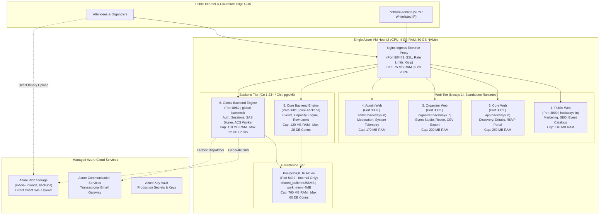

# System-Wide Architecture Context

## 1. Overview & System Mission

Hackways is a high-reliability event discovery, ticket allocation, and attendee registration platform. It is engineered to operate on a single, resource-constrained Azure Virtual Machine (**Standard_B2s or Standard_D2s_v5: 2 vCPU, 4 GB RAM, 50 GB NVMe SSD**) while delivering sub-millisecond concurrency safety under registration spikes.

To maintain modular development velocity and allow future zero-downtime horizontal scaling, the platform decouples into **six independent application runtimes** and **one authoritative database**, mediated by an Nginx ingress reverse proxy and Cloudflare CDN.

---

## 2. The Six Application Services



### Detailed Service Responsibilities:

| Service | Technology | Domain & Routing | Primary Responsibilities |
|:---|:---|:---|:---|
| **Public Web** | Next.js 14 SSG/ISR | `hackways.in` | Public landing pages, marketing, SEO metadata, pre-rendered catalogs. |
| **Core Web** | Next.js 14 App Router | `app.hackways.in` | Attendee event discovery, details, tickets, and interactive RSVP flows. |
| **Organizer Web** | Next.js 14 App Router | `organizer.hackways.in` | Event creation studio, ticket tier controls, attendee roster, CSV exports. |
| **Admin Web** | Next.js 14 App Router | `admin.hackways.in` *(VPN/IP only)* | Platform auditing, user moderation, event controls, health overview. |
| **Core Backend** | Go 1.23+ (`chi` + `pgx/v5`) | `core-backend:8081` | Event lifecycle, ticket inventory, transactional RSVP capacity engine. |
| **Global Backend**| Go 1.23+ (`chi` + `pgx/v5`) | `global-backend:8082`| Sessions, RBAC, Azure Blob SAS signing, ACS Email outbox worker. |

---

## 3. Authoritative Ownership of Business Logic & Data

Under [`AGENTS.md` Rule 1.2 & Rule 1.3](../../AGENTS.md#L26-L50):
- **Go Backend Engines own authoritative business logic:** Authorization, resource ownership, transactional row locking, and database mutations are strictly performed in Go.
- **Frontend applications are presentation layers:** Next.js uses React Server Components (RSC) and Server Actions for data display and proxying to backend APIs. Frontend checks are cosmetic only and never constitute a security boundary.
- **PostgreSQL 16 is the single source of truth:** All data integrity is guaranteed via database constraints, transactions, and foreign keys. Local JSON files, memory maps, or client state cannot substitute for PostgreSQL.

---

## 4. Azure Managed Services Integrations

### 4.1 Azure Blob Storage (Zero-Disk Upload Architecture)
- **Problem:** Storing user media (event banners, attendee avatars) on the VM's 50 GB NVMe disk risks disk exhaustion and RAM saturation.
- **Architecture:** The client requests an upload authorization URL from `global-backend` (`POST /api/v1/storage/upload-intent`). The backend signs a **Write-Only User Delegation Shared Access Signature (SAS)** token with a 15-minute expiration.
- **Direct Upload:** The client browser uploads the binary payload directly to Azure Blob Storage (`https://<account>.blob.core.windows.net/media-uploads/...`). The media payload **never traverses or buffers inside Go application memory or VM disk**.
- **CDN Caching:** Public read traffic is served directly via Cloudflare Edge CDN caching from the `media-uploads` container.

### 4.2 Azure Communication Services (ACS) Email (Transactional Outbox)
- **Problem:** Sending emails synchronously during HTTP requests adds 300–800ms of latency and risks silent notification loss if network blips occur.
- **Architecture:** The confirmation endpoint inserts an outbox record into `email_outbox` inside the same PostgreSQL transaction that confirms the RSVP.
- **Asynchronous Worker:** A bounded, 2-goroutine background worker inside `global-backend` polls pending outbox entries (`SELECT ... FOR UPDATE SKIP LOCKED`), dispatches them via the Azure Communication Services REST API, and applies exponential backoff for retries.

---

## 5. Concurrency Invariants & Capacity Locking

The central invariant of Hackways is: **An event with capacity $C$ must NEVER confirm more than $C$ attendees under any concurrent load.**

```sql
-- Executed inside an isolated PostgreSQL transaction in Core Backend:
BEGIN;

-- 1. Pessimistic lock with 2-second timeout to prevent pool starvation
SET LOCAL statement_timeout = '2000ms';

SELECT id, capacity, current_rsvp_count, status
FROM events
WHERE id = $1 AND deleted_at IS NULL
FOR UPDATE;

-- Application verification in Go:
-- IF status != 'published' -> ROLLBACK -> RETURN ErrEventNotOpen
-- IF current_rsvp_count >= capacity -> ROLLBACK -> RETURN ErrCapacityFull

-- 2. Idempotent reservation insert (Database constraint prevents double-registration)
INSERT INTO rsvps (id, event_id, user_id, status, created_at, updated_at)
VALUES (gen_random_uuid(), $1, $2, 'confirmed', NOW(), NOW())
ON CONFLICT (event_id, user_id) DO NOTHING;

-- IF rows_affected == 0 -> ROLLBACK -> RETURN ErrAlreadyRegistered

-- 3. Atomic capacity counter increment
UPDATE events
SET current_rsvp_count = current_rsvp_count + 1,
    updated_at = NOW()
WHERE id = $1;

-- 4. Enqueue confirmation email atomically into transactional outbox
INSERT INTO email_outbox (id, recipient_email, recipient_name, template_type, payload_json, status, created_at)
VALUES (gen_random_uuid(), $3, $4, 'rsvp_confirmation', $5, 'pending', NOW());

COMMIT;
```

---

## 6. Defensive Memory & Resource Limits (Azure VM)

The production environment is strictly budgeted for a **2 vCPU, 4 GB RAM, 50 GB NVMe** single-VM host:

| Service / Container | Resident (RSS) | Docker Hard Limit | CPU Quota (Max 2.0) | Memory Governance Strategy |
|:---|:---|:---|:---|:---|
| **PostgreSQL 16** | ~220 MB | **700 MB** | 0.60 | `shared_buffers = 256MB`, `work_mem = 4MB`, `max_connections = 60` |
| **Core Backend (Go)** | ~35 MB | **120 MB** | 0.70 | `GOMEMLIMIT=100MiB`, `GOGC=100` |
| **Global Backend (Go)** | ~35 MB | **110 MB** | 0.40 | `GOMEMLIMIT=90MiB`, `GOGC=100`, bounded 2-routine email worker |
| **Core Web (Next.js)** | ~110 MB | **250 MB** | 0.50 | `NODE_OPTIONS="--max-old-space-size=190"`, standalone output |
| **Organizer Web (Next.js)**| ~100 MB | **230 MB** | 0.40 | `NODE_OPTIONS="--max-old-space-size=180"`, standalone output |
| **Admin Web (Next.js)** | ~80 MB | **170 MB** | 0.25 | `NODE_OPTIONS="--max-old-space-size=130"`, standalone output |
| **Public Web (Next.js)** | ~60 MB | **140 MB** | 0.25 | `NODE_OPTIONS="--max-old-space-size=100"`, standalone output |
| **Nginx Ingress** | ~25 MB | **75 MB** | 0.20 | Event loop worker processes: 2, worker_connections: 4096 |
| **Host Linux OS & System** | ~350 MB | ~500 MB | 0.20 | Systemd, SSH, journald, Docker daemon |
| **Ceiling Total** | **~1,215 MB** | **~2,495 MB** | **~3.50 (Burstable)**| **Safe Headroom: ~1,601 MB for disk page cache & spikes** |

### Host Safety Policies:
1. **Off-Node Builds:** **Never run `npm run build` or `next build` on the VM.** Container images are compiled in GitHub Actions CI with `output: 'standalone'` and pulled pre-built.
2. **NVMe Swap Safety Net:** A **3.0 GB swapfile** with `vm.swappiness = 10` provides an emergency buffer.
3. **Strict Docker Log Rotation:** `/etc/docker/daemon.json` restricts container logs to `max-size: "10m"`, `max-file: "3"`, capping total log disk usage at 210 MB.
