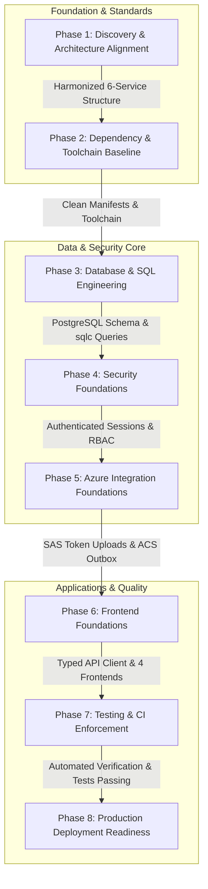

# Cross-Phase Dependency & Component Map

## 1. Phase Dependency Graph

Implementation across the eight phases is strictly sequential. Tasks in downstream phases cannot be marked `IN_PROGRESS` or `VERIFIED` until prerequisite phase gates have been satisfied.

---

## 2. Component Dependency Matrix

| Component | Depends On | Depended Upon By | Primary Interfaces / Contracts |
|:---|:---|:---|:---|
| **PostgreSQL 16** | Docker Engine / VM Host | Core Backend, Global Backend, Migrations | TCP :5432, `pgxpool`, binary SQL protocol |
| **`core-backend`** | PostgreSQL, `pgx/v5`, `sqlc` | Core Web, Organizer Web, Nginx Ingress | REST `/api/v1/events/*`, `/api/v1/rsvps/*` (Port 8081) |
| **`global-backend`**| PostgreSQL, Azure Blob Storage, Azure ACS | All Frontends, Nginx Ingress | REST `/api/v1/auth/*`, `/api/v1/storage/*` (Port 8082) |
| **`packages/api-client`** | TypeScript compiler | All 4 Next.js applications | Shared TypeScript SDK & domain types |
| **`public-web`** | `packages/api-client`, Global Backend | Public Users, Edge CDN | Next.js SSG/ISR Port 3000 (`hackways.in`) |
| **`core-web`** | `packages/api-client`, Core Backend, Global Backend | Attendee Users, Nginx | Next.js App Router Port 3001 (`app.hackways.in`) |
| **`organizer-web`**| `packages/api-client`, Core Backend, Global Backend | Organizers, Nginx | Next.js App Router Port 3002 (`organizer.hackways.in`) |
| **`admin-web`** | `packages/api-client`, Global Backend, Core Backend | Admins (dedicated session, platform grant, daily OTP) | Next.js App Router Port 3003 (`admin.hackways.in`) |
| **Nginx Ingress** | Docker network, All 6 services | Cloudflare Edge CDN | Ports 80/443, SSL termination, reverse proxy |

---

## 3. Blocking Decisions & Prerequisites Register

The following explicit decisions and prerequisites must be resolved at each phase gate:

| Decision ID | Summary | Blocks | Prerequisite For | Current Status |
|:---:|:---|:---:|:---|:---:|
| **DEC-001** | Approve directory structure alignment (6 distinct folders vs monolithic transition). | Phase 1 Exit Gate | Phase 2 Scaffolding | `PROPOSED` |
| **DEC-002** | Purge untracked `LICENSE` (OpenAI Apps SDK guidelines) and enforce proprietary notice. | Phase 1 Exit Gate | Repository Cleanliness | `APPROVED` |
| **DEC-003** | Remove `lucide-react` from `apps/web/package.json` and lockfiles. | Phase 2 Exit Gate | Frontend Toolchain | `APPROVED` |
| **DEC-004** | Harmonize schema table names (`rsvps` vs `registrations`, `email_outbox` vs `notifications`). | Phase 3 Exit Gate | Database Migrations & sqlc | `PROPOSED` |
| **DEC-005** | Select icon library alternative to `lucide-react` (inline SVGs or `@heroicons/react`). | Phase 6 Exit Gate | Frontend Components | `PROPOSED` |
| **DEC-006** | Approve Azure Key Vault secret injection mechanism vs `.env` VM deployment. | Phase 8 Exit Gate | Production Deployment | `PROPOSED` |

---

## 4. Phase-by-Phase Task Readiness

- **Phase 1 Tasks (`P1-DISC-*`):** Unblocked. Active.
- **Phase 2 Tasks (`P2-TOOL-*`):** Blocked on Phase 1 exit gate (decision on 6 service folders).
- **Phase 3 Tasks (`P3-DB-*`):** Blocked on Phase 2 exit gate (`pgx/v5` added to Go dependencies).
- **Phase 4 Tasks (`P4-SEC-*`):** Blocked on Phase 3 exit gate (PostgreSQL session table & sqlc models active).
- **Phase 5 Tasks (`P5-AZURE-*`):** Blocked on Phase 4 exit gate (authenticated endpoints for upload intent).
- **Phase 6 Tasks (`P6-FE-*`):** Blocked on Phase 5 exit gate (API endpoints available for typed client consumption).
- **Phase 7 Tasks (`P7-TEST-*`):** Blocked on Phase 6 exit gate (real frontend components ready for testing).
- **Phase 8 Tasks (`P8-OPS-*`):** Blocked on Phase 7 exit gate (all automated tests and builds passing).
