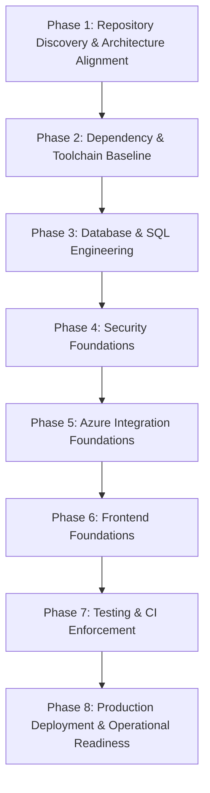

# Hackways Master Engineering Plan

## 1. Executive Summary & Objective

Hackways is an event discovery, organizer management, and attendee RSVP platform engineered to eliminate capacity race conditions and overbooking. This **Master Engineering Plan** establishes the sequential execution roadmap across eight foundation phases required to transition the codebase from its initial scaffolding to a verified, production-ready, multi-service architecture running on an Azure Virtual Machine (**2 vCPU, 4 GB RAM, 50 GB NVMe SSD**).

---

## 2. Fixed Execution Phase Sequence

The platform must be developed through strictly ordered, dependency-gated phases. **Phases may not be merged, reordered, or skipped.**

| Phase | Phase Name | Primary Objective | Key Exit Deliverable | Status |
|:---:|:---|:---|:---|:---:|
| **Phase 1** | **Repository Discovery & Architecture Alignment** | Reconcile disk structure with canonical 6-service architecture; resolve untracked files and specification conflicts. | Harmonized directory structure; baseline context packages created. | `VERIFIED` |
| **Phase 2** | **Dependency & Toolchain Baseline** | Clean package manifests, purge prohibited dependencies (`lucide-react`), configure independent builds and workspace links. | Clean `package.json`, `go.mod`, standalone Next.js config; zero prohibited dependencies. | `VERIFIED` |
| **Phase 3** | **Database & SQL Engineering** | Reconcile PostgreSQL migrations, naming conventions (`rsvps`, `email_outbox`), `sqlc` compiled queries, and connection pools. | Numbered migrations applied cleanly; `sqlc generate` verified; `pgxpool` active. | `VERIFIED` |
| **Phase 4** | **Security Foundations** | Implement cryptographic host cookies (`__Host-hackways_session`), session validation middleware, RBAC, and IDOR protection. | Server-side authentication and authorization guards verified with negative security tests. | `VERIFIED` |
| **Phase 5** | **Azure Integration Foundations** | Implement Azure Blob Storage direct client SAS token generation (zero VM disk uploads) and ACS email transactional outbox worker. | SAS generator active; 2-goroutine outbox worker polling and dispatching emails. | `VERIFIED` |
| **Phase 6** | **Frontend Foundations** | Establish all 4 independent Next.js applications (`public-web`, `core-web`, `organizer-web`, `admin-web`) with typed API contracts. | 4 independent frontend apps running with genuine server-rendered data and no mock data. | `VERIFIED` |
| **Phase 7** | **Testing & CI Enforcement** | Build automated test suites: backend race detector, DB integration, frontend type-check, and k6 concurrency tests. | CI passing with 100% real command verification; zero simulated success states. | `VERIFIED` |
| **Phase 8** | **Production Deployment & Operational Readiness** | Deploy production Docker Compose topology, Nginx ingress, memory caps, log rotation, and automated backup scripts. | Verified container stack running within Azure VM resource budget (< 2.5 GB RAM total). | `VERIFIED` |

---

## 3. The Six Independent Production Services

Merging, combining, or blurring the boundaries of these six services is **strictly prohibited** by [`AGENTS.md` Section 2.1](../../AGENTS.md#L94-L117):

1. **`apps/public-web`**: Next.js 14 SSG/ISR (`hackways.in`) — Marketing landing, event discovery, public SEO catalogs. (Memory cap: 140 MB).
2. **`apps/core-web`**: Next.js 14 App Router (`app.hackways.in`) — Attendee event details, interactive tickets, and RSVP flows. (Memory cap: 250 MB).
3. **`apps/organizer-web`**: Next.js 14 App Router (`organizer.hackways.in`) — Organizer event creation studio, ticket tier controls, roster management, CSV exports. (Memory cap: 230 MB).
4. **`apps/admin-web`**: Next.js 14 App Router (`admin.hackways.in`) — Network/VPN-isolated administration, user moderation, event auditing. (Memory cap: 170 MB).
5. **`services/core-backend`**: Go 1.23+ (`core-backend:8081`) — High-concurrency event lifecycle, ticket inventory, pessimistic RSVP capacity locks. (Memory cap: 120 MB).
6. **`services/global-backend`**: Go 1.23+ (`global-backend:8082`) — Authentication, sessions, RBAC, Azure Blob SAS token signing, ACS email outbox worker. (Memory cap: 110 MB).

---

## 4. Cross-Phase Acceptance Criteria & Exit Gates

A phase cannot be marked `VERIFIED` without meeting its mandatory exit criteria:

### Phase Gate 1 (Phase 1 -> Phase 2)
- All 8 phase planning directories and 6 master documents exist and are fully populated.
- Untracked `LICENSE` anomaly resolved (purged or replaced with proprietary notice).
- Service layout decision approved: 6 decoupled directories mapped and ready for scaffolding.

### Phase Gate 2 (Phase 2 -> Phase 3)
- `lucide-react` completely removed from `apps/web/package.json` and lockfiles.
- `output: 'standalone'` present in all Next.js configurations.
- `services/api/go.mod` (or service modules) includes `github.com/jackc/pgx/v5`.
- `gofmt -l .` reports 0 unformatted Go files (line endings normalized to LF).

### Phase Gate 3 (Phase 3 -> Phase 4)
- PostgreSQL schema terminology reconciled (`rsvps` table, `email_outbox` table).
- Migrations apply up and rollback down cleanly via `golang-migrate`.
- `sqlc generate` succeeds with 0 errors, emitting type-safe Go structs in `db/`.
- Backend initializes `pgxpool.Pool` adhering to connection caps (core max 28, global max 22).

### Phase Gate 4 (Phase 4 -> Phase 5)
- Stateful session authentication verified with PostgreSQL.
- Cookies scoped to `__Host-hackways_session` (Lax) and `__Host-hackways_admin_session` (Strict).
- Server-side IDOR checks enforced on organizer mutation queries.

### Phase Gate 5 (Phase 5 -> Phase 6)
- Azure Blob Storage SAS generation endpoint operational (write-only, 15-min expiry).
- Zero media stored on VM disk (`./uploads` driver purged).
- Outbox worker polls `email_outbox` and marks entries `sent` or handles retries.

### Phase Gate 6 (Phase 6 -> Phase 7)
- Zero mock data in frontend pages (`SAMPLE_EVENTS` and `alert()` popups eliminated).
- All 4 frontends consume typed backend API endpoints.
- Server-side rendering (SSR/RSC) used for initial data render; zero layout shift or empty flashes.

### Phase Gate 7 (Phase 7 -> Phase 8)
- Go unit and race tests pass: `go test ./... -v -race -count=1`.
- Concurrency test passes: 500 concurrent requests against a 50-capacity event confirms exactly 50 attendees with zero overbooking.
- CI pipeline completes cleanly on GitHub Actions.

### Phase Gate 8 (Foundation Complete)
- Docker Compose production stack starts all 7 containers (Nginx + 4 Web + 2 Backend + PostgreSQL).
- Total container RSS memory remains safely under the 2,495 MB cap.
- Log rotation verified (`10m x 3` max per container).

---

## 5. Non-Goals During Foundation Work
- Implementing non-core third-party payment gateways (Stripe/Razorpay) before core ticketing works.
- Over-engineering distributed queues (Kafka/RabbitMQ) when PostgreSQL transactional outbox suffices.
- Implementing client-side optimistic RSVP updates that bypass database row locking.
