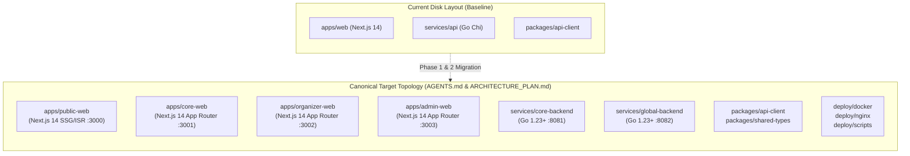

# Phase 1 Technical Architecture: Discovery & Service Alignment

## 1. Scope & Component Responsibility
Phase 1 focuses on reconciling the actual repository structure with the canonical 6-service monorepo architecture mandated by [`AGENTS.md`](../../AGENTS.md).

---

## 2. Directory Mapping & Transition Strategy

To adhere strictly to the rule prohibiting merged services without breaking current builds:
1. **Frontend Transition:**
   - `apps/web` contains the foundation for attendee discovery and event detail views. This code maps directly to `apps/core-web`.
   - `apps/public-web`, `apps/organizer-web`, and `apps/admin-web` will be scaffolded as independent Next.js standalone projects.
2. **Backend Transition:**
   - `services/api` currently houses platform middleware, config, and query templates.
   - Event lifecycle and RSVP capacity logic will reside in `services/core-backend` (:8081).
   - Auth, sessions, Azure Blob SAS signing, and ACS email worker will reside in `services/global-backend` (:8082).
3. **Infrastructure Scaffolding:**
   - Establish `deploy/docker/`, `deploy/nginx/`, and `deploy/scripts/` to house production Compose topologies and Nginx rate-limiting configs.

---

## 3. Failure Modes & Risks in Phase 1
- **Accidental Breaking Refactors:** Moving files prematurely before dependencies are installed can break CI. All file migrations must be accompanied by updated Makefile and CI targets.
- **Lost History:** File moves must use `git mv` where possible to preserve commit provenance.
