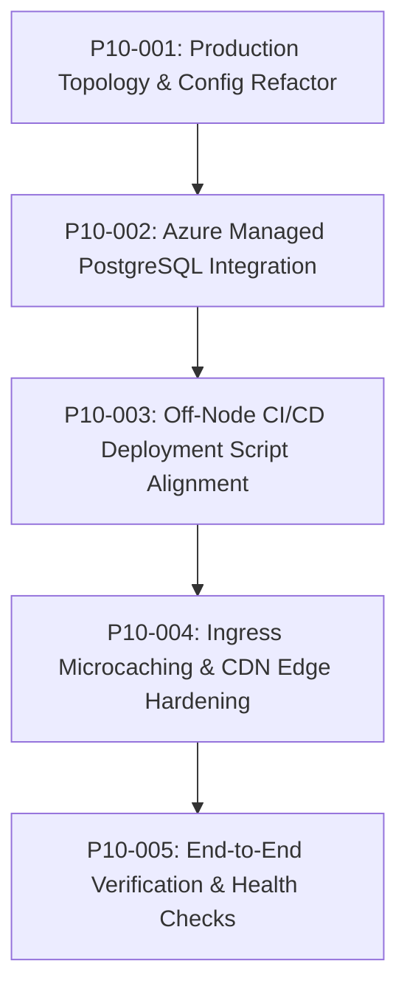

# Phase 10: Azure Managed Cloud Migration & Scalability Hardening — Execution Plan

## 1. Phase Objective & Overview

Phase 10 transitions the Hackways production persistence layer from local containerized PostgreSQL to **Azure Database for PostgreSQL Flexible Server**, tightly integrates **Azure Blob Storage** direct SAS uploads and **Azure Communication Services (ACS)** transactional email outbox delivery, and rebalances single-VM compute allocations to unlock maximum concurrency and stability under high attendee loads.

---

## 2. Work Breakdown Structure (WBS)

### Task Specifications

#### Task 1: `P10-001` — Production Topology & Config Refactor
- Update `deploy/docker/docker-compose.prod.yml` to remove the local PostgreSQL container.
- Connect `core-backend` and `global-backend` directly to Azure Database for PostgreSQL Flexible Server via `DATABASE_URL` with `sslmode=require`.
- Reallocate container RAM limits on the 4 GB VM:
  - `core-backend`: 180 MB (GOMEMLIMIT=150MiB, pool max 32)
  - `global-backend`: 140 MB (GOMEMLIMIT=120MiB, pool max 24)
  - `nginx`: 80 MB (worker connections 4096)
  - Next.js runtimes: 260 MB (`core-web`), 240 MB (`organizer-web`), 170 MB (`admin-web`), 140 MB (`public-web`)
- Expand host free memory buffer to > 2.3 GB (~58% free).

#### Task 2: `P10-002` — Azure Managed PostgreSQL Integration
- Verify `DATABASE_URL` connection parameters format:
  `postgres://<user>:<password>@<server-name>.postgres.database.azure.com:5432/<db_name>?sslmode=require`
- Ensure `000001_initial_schema.up.sql` applies cleanly against Azure PostgreSQL.
- Verify `SET LOCAL statement_timeout = '2000ms'` in transactional capacity locks.

#### Task 3: `P10-003` — Off-Node CI/CD Deployment Script Alignment
- Update `deploy/scripts/deploy.sh` to remove on-node `docker build` commands.
- Pull pre-compiled container images directly from container registry (`ghcr.io/varshith-dev/hackways-*`), preventing CPU spikes and memory exhaustion on the 2-vCPU / 4 GB production VM during releases.

#### Task 4: `P10-004` — Ingress Microcaching & CDN Edge Hardening
- Configure Nginx microcaching for public read routes (`/api/v1/events` 15-second TTL with `stale-while-revalidate`).
- Enforce immutable edge caching for Next.js static assets (`/_next/static/*`).

#### Task 5: `P10-005` — End-to-End Verification & Health Checks
- Verify health endpoints (`/health`) on both Go engines over SSL with Azure PostgreSQL.
- Run Go race detection test suite and frontend type-checks.
- Validate that zero secrets or local storage artifacts exist on the VM disk.
