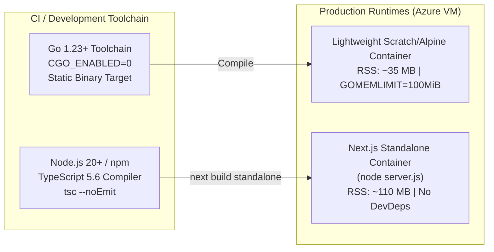

# Phase 2 Technical Architecture: Toolchains & Build Boundaries

## 1. Toolchain & Build Architecture
To guarantee deployment stability on the 2 vCPU / 4 GB RAM Azure VM, the build system enforces strict isolation between development dependencies, production dependencies, and runtime container images.

---

## 2. Next.js Standalone Packaging (`output: 'standalone'`)
- Standard Next.js production builds include full `node_modules` and framework overhead, producing Docker images > 1 GB and memory footprints > 400 MB.
- By configuring `output: 'standalone'`, Next.js traces dependency usage and emits a self-contained `.next/standalone` folder with only the essential files required to run `node server.js`.
- This reduces container image size from ~1.2 GB to ~220 MB and limits runtime memory usage to ~110–190 MB, safely respecting the 4 GB RAM budget.

---

## 3. Go Module & Driver Isolation (`pgx/v5`)
- Go applications compile to single static binaries with zero external C dependencies (`CGO_ENABLED=0`).
- `github.com/jackc/pgx/v5` is selected as the PostgreSQL driver for native binary protocol performance, structured connection pooling (`pgxpool`), and compile-time compatibility with `sqlc`.
