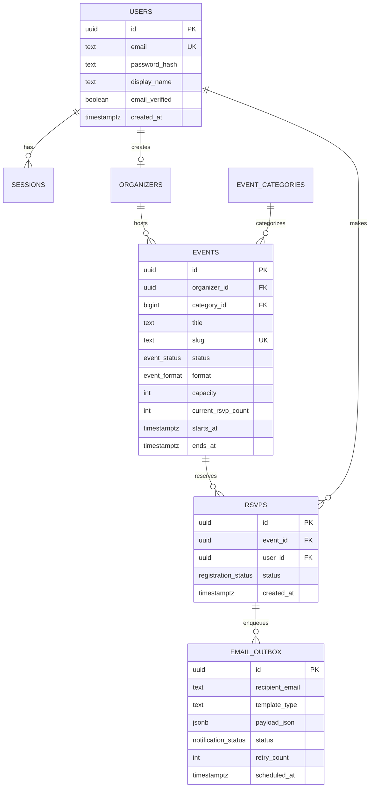

# Phase 3 Technical Architecture: Database & Concurrency Engine

## 1. Relational Schema & Entity Boundaries



---

## 2. Concurrency Control & Statement Timeout Mechanics

1. **Pessimistic Locking:**
   When an RSVP arrives, the backend acquires an exclusive row lock on the event:
   ```sql
   SET LOCAL statement_timeout = '2000ms';
   SELECT id, capacity, current_rsvp_count, status
   FROM events
   WHERE id = $1 AND deleted_at IS NULL
   FOR UPDATE;
   ```
2. **Lock Hold Duration:**
   On the NVMe storage of the Azure VM, lock hold duration is ~1.8–3.2ms. This guarantees clean serialization of 280–380 reservations per second per hot event.
3. **Surge Protection:**
   If lock queue depth exceeds 2000ms, PostgreSQL aborts the transaction cleanly via `statement_timeout`, preventing connection pool starvation.
4. **Idempotent Inserts:**
   Database unique constraint on `(event_id, user_id)` guarantees that repeated clicks or duplicate network packets never create duplicate reservations.

---

## 3. Connection Pool Budgeting (PostgreSQL 16)
- Total allowed database connections: **60**.
- `core-backend` (`pgxpool`): Max 28 connections.
- `global-backend` (`pgxpool`): Max 22 connections.
- Administrative & migrations reserve: 10 connections.
