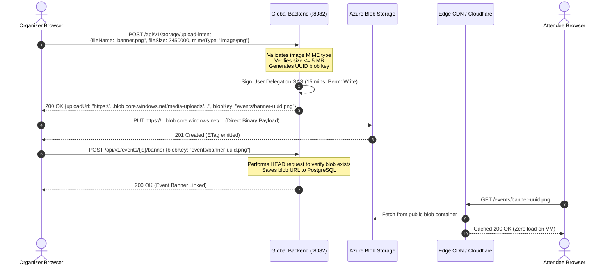
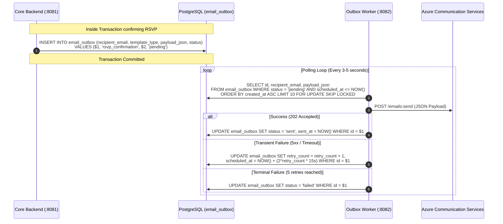

# Phase 5 Technical Architecture: Azure Managed Services Integration

## 1. Direct SAS Upload Flow Architecture

---

## 2. PostgreSQL Transactional Outbox Pattern

---

## 3. Worker Concurrency & Memory Budget
- The outbox worker runs strictly within `global-backend` as a bounded pool of **2 goroutines**.
- Polling uses `LIMIT 10 FOR UPDATE SKIP LOCKED` to prevent query thrashing and allow seamless multi-instance scaling in the future.
- Total worker RSS memory is capped at **< 10 MB**, well within the 110 MB container ceiling for `global-backend`.
