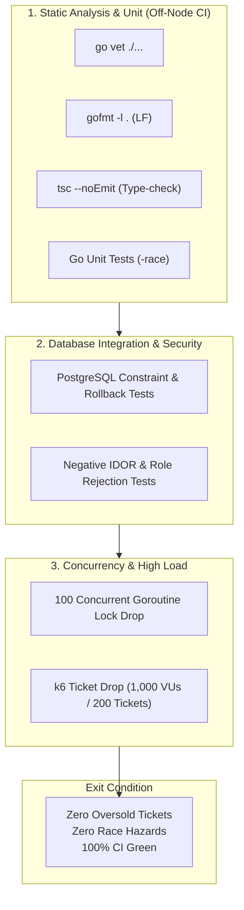

# Phase 7 Technical Architecture: Testing & CI Quality Gates

## 1. Testing Pyramid & Verification Gates

---

## 2. Concurrency Race Testing Architecture
- The concurrency test sets up an isolated event with `capacity = 10` in PostgreSQL.
- It launches 100 simultaneous goroutines that call the RSVP reservation endpoint in parallel:
  - Each goroutine attempts to reserve a unique user ticket.
  - Transactions lock the event row via `SELECT ... FOR UPDATE`.
- The test asserts:
  1. Exactly 10 goroutines receive HTTP 201 Created.
  2. Exactly 90 goroutines receive HTTP 409 Conflict.
  3. The final event record has `current_rsvp_count == 10`.
  4. The Go race detector (`-race`) reports zero data race hazards.

---

## 3. GitHub Actions CI Matrix Strategy
- CI runs in GitHub Actions runners off-node (never on the production VM).
- Jobs:
  - `repo-hygiene`: Verifies no committed `.env` files or leaked private keys.
  - `backend-ci`: Sets up Go 1.23, launches ephemeral PostgreSQL service container, runs `go vet` and `go test ./... -v -race -count=1`.
  - `frontend-ci`: Sets up Node 22, installs dependencies, and runs `npm run type-check` across all 4 frontend applications.
