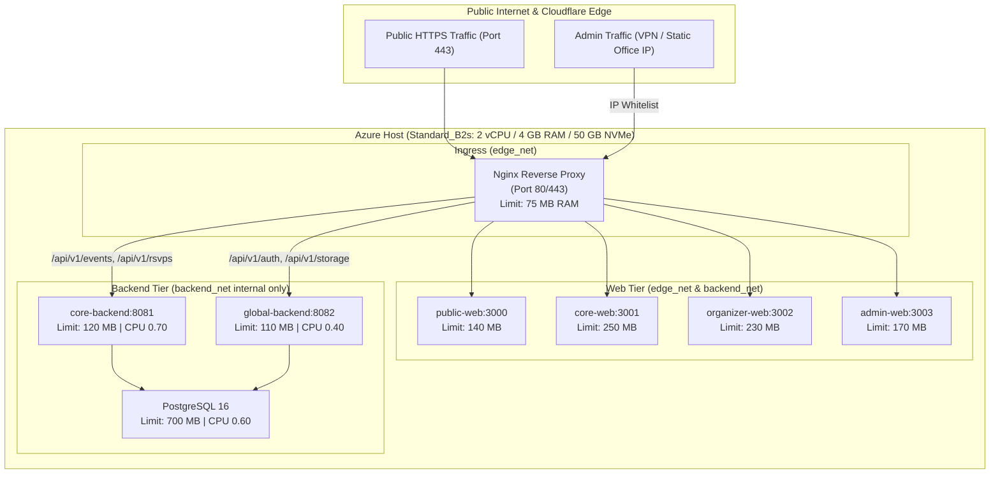

# Phase 8 Technical Architecture: Production Ingress & VM Governance

## 1. Production Docker Network & Ingress Topology

---

## 2. Single-VM Failure Domain & Swap Protection
- Operating all 6 applications and PostgreSQL on a single VM means any memory leak could trigger an out-of-memory kernel panic.
- **Defensive Safeguards:**
  1. Every container enforces `deploy.resources.limits.memory`.
  2. The sum of all container memory caps is **2,495 MB**, leaving **1,601 MB** of physical RAM available for OS kernel, disk page cache, and buffer headroom.
  3. A **3.0 GB NVMe swapfile** with `vm.swappiness = 10` serves as a safety buffer against sudden spikes without causing premature disk thrashing.

---

## 3. Rate Limiting Zones (Nginx)
To shield the 2 vCPU VM from volumetric denial-of-service and brute force attacks:
- `auth_zone`: `5r/s` (burst=5 nodelay) on `/api/v1/auth/*`.
- `rsvp_zone`: `10r/s` (burst=5 nodelay) on `/api/v1/rsvps/*`.
- `general_zone`: `30r/s` (burst=20 nodelay) across all other API routes.
