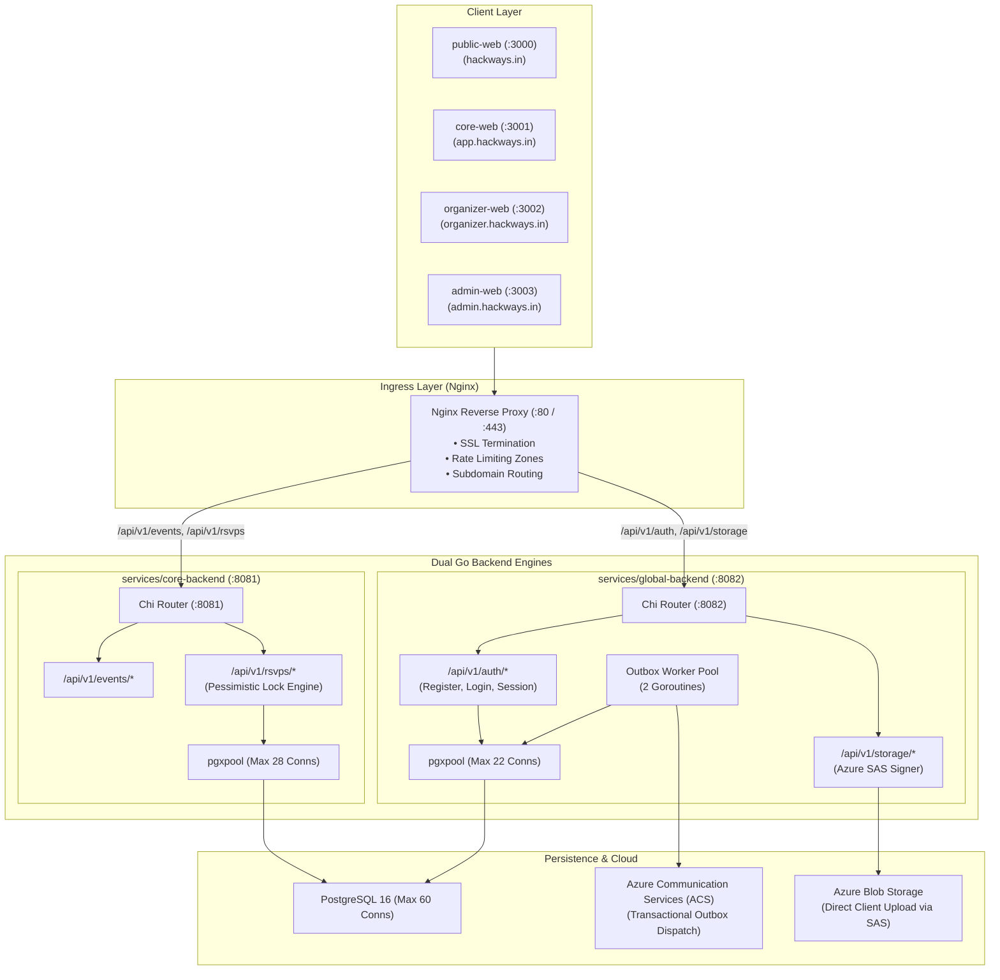

# Phase 9 Architecture Specification: Dual Go Backend Engines

## 1. Domain & Runtime Boundaries

---

## 2. PostgreSQL Connection Pool Allocation
- Total Instance Cap: **60 connections**
- `services/core-backend`: **Max 28 connections** (Min 4, Idle 15m)
- `services/global-backend`: **Max 22 connections** (Min 3, Idle 15m)
- Admin, migrations, CLI: **10 connections reserved**

---

## 3. Memory & Resource Governance
- `core-backend`: `GOMEMLIMIT=100MiB`, `GOGC=100`, Docker memory cap **120 MB**, CPU quota 0.70.
- `global-backend`: `GOMEMLIMIT=90MiB`, `GOGC=100`, Docker memory cap **110 MB**, CPU quota 0.40.
